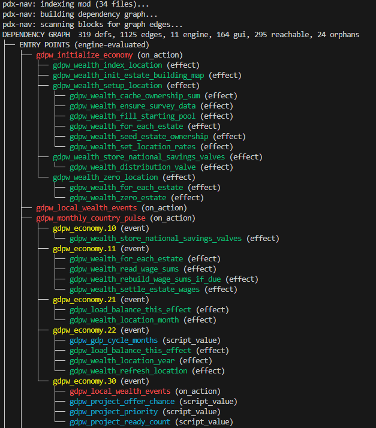

# pdx-nav

IDE-style navigation for EU5 PDX script and GUI, across mod + vanilla. Built
for agent workflows: every result carries the enclosing definition and its
exact line span, so the next step is a surgical read instead of another broad
grep.

## Commands

```bash
pdx-nav def <name>...        # definitions in all sources, overrides (INJECT/REPLACE) included
pdx-nav show <name>          # print the block (--vanilla/--mod, -n max lines)
pdx-nav context <name>       # show definition with parent hierarchy (indentation walk-up)
pdx-nav refs <name>...       # all references, role-tagged (definition/use/string/override)
pdx-nav callers <name>       # definitions whose block references <name>
pdx-nav stack <name>         # transitive caller tree up to on_action entry points
pdx-nav vars <name>          # variable write/read sites (set_variable family vs var:/has_variable)
pdx-nav list <glob> [--kind] # enumerate definitions
pdx-nav list --file <path>   # list all definitions in one file (file order)
pdx-nav grep <pattern>       # full-text search over indexed symbol names
pdx-nav graph                # dependency graph: trees, orphans, cross-system edges
pdx-nav rename <old> <new>   # rename a symbol in every mod file (--dry-run first)
pdx-nav rename --batch pairs.tsv --dry-run   # old<TAB>new per line
pdx-nav rebuild [--full]     # verify indexes now (edits are picked up automatically)
```

`rename` edits mod files only. After the rename report it lists every vanilla
line that still names an old name, with its role: a vanilla definition of the
same name, or a vanilla reference (an advance that unlocks it, an event that
checks it). The mod must override those vanilla files, or keep the old name.

`stack` reconstructs dispatch chains end to end, e.g.:

```
sul_estate_wages_pay_all (effect .../sul_estate_wages.txt:19-25, mod)
^ sul_wealth_monthly_update (effect .../sul_wealth_core.txt:292-329, mod)
  ^ sul_economy.10 (event .../sul_economy_events.txt:6-14, mod)
    ^ sul_monthly_country_pulse (on_action .../sul_parallel_on_actions.txt:5-14, mod) [entry point]
      ^ monthly_country_pulse (on_action .../sul_hardcoded.txt:59-65, mod) [entry point]
```

`refs`/`vars` also detect `$param$`-templated constructions
(`sul_pay_frac_$ESTATE$`) that expand to the queried name. Without this,
generated names look like they are never written.

`graph` builds a color-coded dependency tree of the full mod: which on_actions
the engine calls, what they dispatch, where subsystems connect, and what is
orphaned. Drill into any definition with `graph <name>`, or trace callers
upstream with `graph <name> --up`.

Reachability is always traced through every definition in the mod, whatever
`--kind`/`--all` shows: `graph --orphans-only --kind trigger` lists triggers
nothing reaches, not triggers whose callers happen to be other kinds. Roots
are on_actions and other engine-evaluated kinds, names used in `.gui` data
binding, engine-loaded database definitions (buildings, advances, laws, map
data...), and overrides of vanilla names (vanilla's callers now run the mod's
version). Data-binding expressions inside strings (`"[TC.GetTag]"`) and loc
text count as references, and `<name>`/`<name>_desc` loc keys belong to their
definition. Hidden kinds are collapsed out of the trees, so `--kind event`
shows the events on_actions fire as entry points.



## What it indexes

Scripts (.txt), GUI (.gui), and localization (.yml) across all three EU5
domains (in_game, main_menu, loading_screen). Definition kinds:

- **Script**: effects, triggers, script_values, on_actions, events, buildings,
  production methods, reforms, privileges, and all other `common/` directories
- **GUI**: templates, types, local_templates, types blocks, `@variable`
  definitions (gui_var)
- **Localization**: loc keys from `l_english` yml files

Top-level blocks only; `INJECT:`/`REPLACE:`/`TRY_INJECT:` prefixes are
recorded as override flags.

## How it works

- **Index** (definitions, kinds, line spans, per-file signatures): cached
  under `~/.cache/pdx-nav/` (`mod-<hash>`, `tracker-<version>`, or the
  install hash) on the native filesystem.
- **Corpus**: a local concatenated copy (`fileid:line:text`) of all indexed
  files, so reference queries ripgrep one native-filesystem file instead of
  crawling thousands of files on a slow /mnt drive.
- **Incremental refresh**: every file carries a signature (mtime/size on
  disk, blob sha in git). A refresh reparses only files whose signature
  changed and splices everything else from the previous corpus, so an edit
  costs one file's parse. The graph caches per-file tokens the same way.
- **Mod**: re-stats its tree on every invocation (threaded, ~0.2s over /mnt)
  and refreshes synchronously, so results always reflect the latest edit.
- **Vanilla**: never blocks once an index exists. A patch (the install's
  `binaries/checksum.txt` sentinel changes) or a new vanilla-tracker tag is
  rebuilt by a detached background process while queries keep answering from
  the previous index (a stderr note says so). A new tracker version reuses
  every unchanged blob from an existing version, so it builds in seconds.
  Without a sentinel, the install is re-verified in the background every 10
  minutes. Only the very first build blocks.
- **Concurrency**: builds take a per-cache lock and publish atomically, so
  parallel agents never double-build or read a half-written index.
- `pdx-nav rebuild` re-verifies in the foreground (cheap); `--full` discards
  the caches and reparses everything; `--mod-only` skips vanilla.
- **Vanilla tracker**: when a bare git repo is found at
  `$PDX_VANILLA_REPO` or `<mod-parent>/vanilla-tracker/repo.git`, it is used
  instead of the live game install. `--at <version>` selects a specific tag.
- **Hit classification** uses a comment/string-aware scanner: hits inside
  comments are hidden by default, hits inside string literals are tagged
  `string`, code hits are `use`. Enclosure is resolved from the span index.
- Excluded from indexing: `gfx/map` (generated map-object blobs),
  tool/VCS directories, and non-English vanilla localization (two thirds of
  the vanilla corpus; refs over it only duplicated English hits).

## Package structure

```
pdx_nav/
  constants.py   # paths, regex patterns, kind maps
  scanner.py     # comment/string-aware line parser (split_line)
  paths.py       # mod/vanilla root discovery, file collection
  parsing.py     # definition parsing (parse_defs, kind_for_path)
  source.py      # Source/GitSource classes, index building, vanilla-tracker
  classify.py    # hit classification, reference gathering, template matching
  output.py      # formatting, color, suggestions
  commands.py    # def, show, context, refs, callers, stack, vars, list, grep, rebuild
  graph.py       # dependency graph building, reachability, graph command
  cli.py         # argument parsing and dispatch
pdx_nav.py       # thin shim for symlink compatibility
```

## Setup

```bash
pipx install --editable .
pipx inject pdx-nav --editable ../pdx-utilities
# vanilla root: defaults to the Steam install; override with PDX_GAME_ROOT
```

Shared helpers come from [pdx-utilities](../pdx-utilities), a separate repo checked out next to this one. The inject line makes edits there reach this tool immediately; a non-editable install pulls it from GitHub instead.

First run builds the vanilla index (under a minute from vanilla-tracker;
longer from a /mnt install). Warm queries run in about 0.5s, `graph` in about
1s.

## Known limitations

- Variable write detection is heuristic: a `name = X` line counts as a write
  when a `*_variable*`-family opener is on the same line or within the 4
  lines above (pdx-format's compact style makes this reliable in practice).
- Multi-line string literals are classified per-line during hit
  classification (they only occur in excluded generated gfx files).
- Nested definitions (laws inside law groups, PMs inside buildings) index as
  part of their top-level block, not separately.
